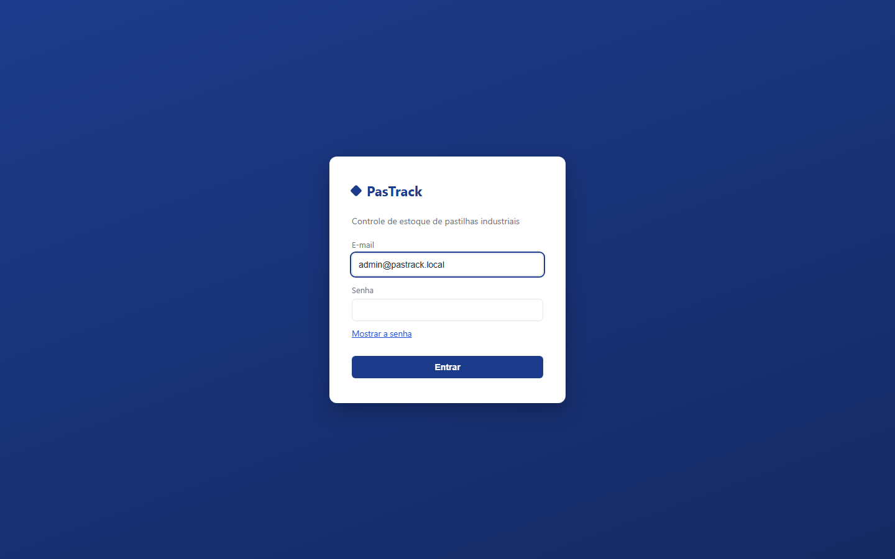
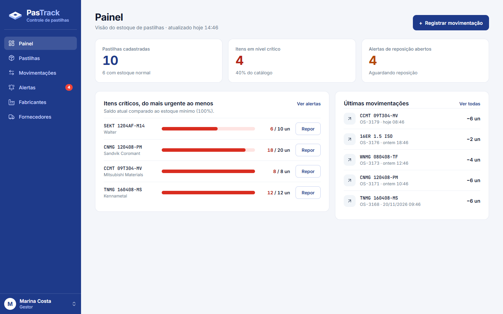
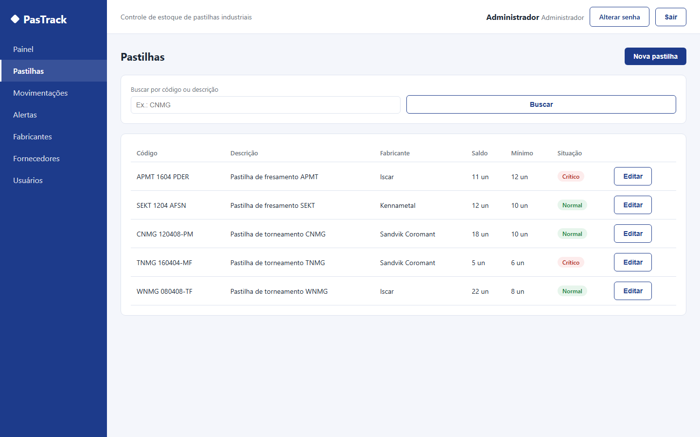
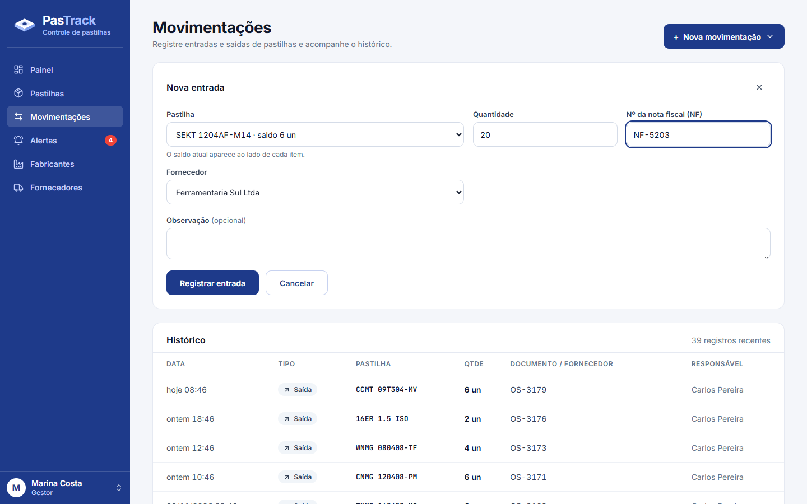
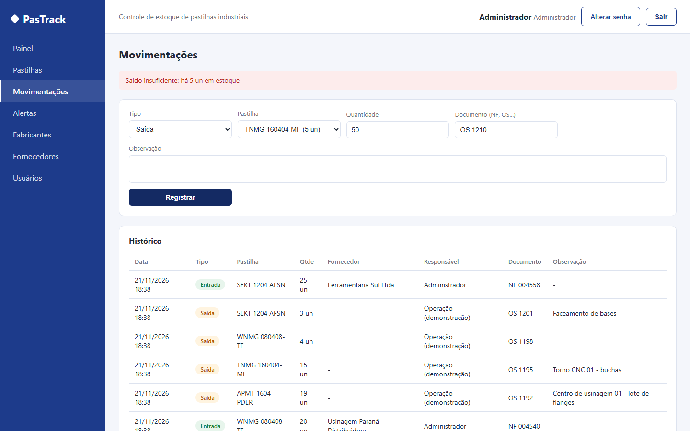
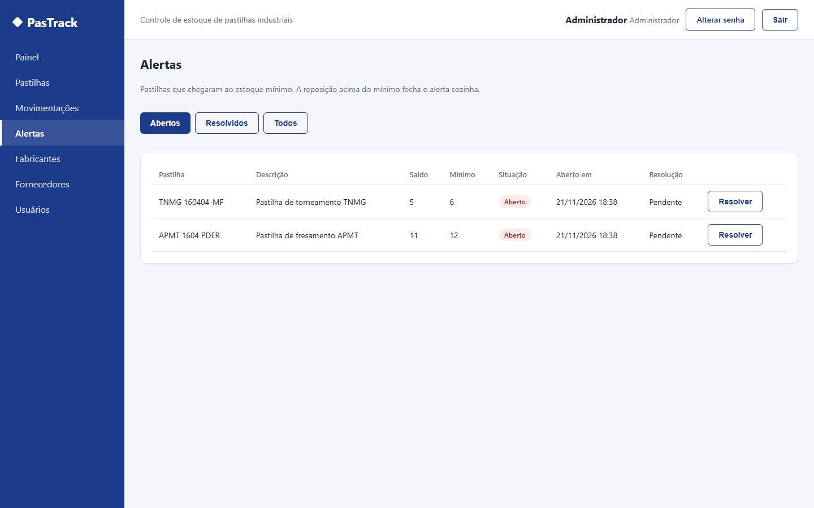
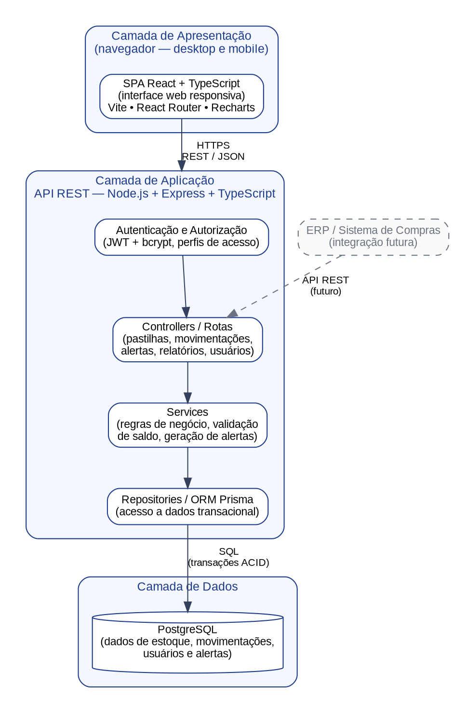
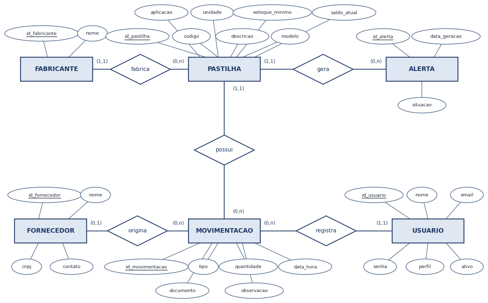
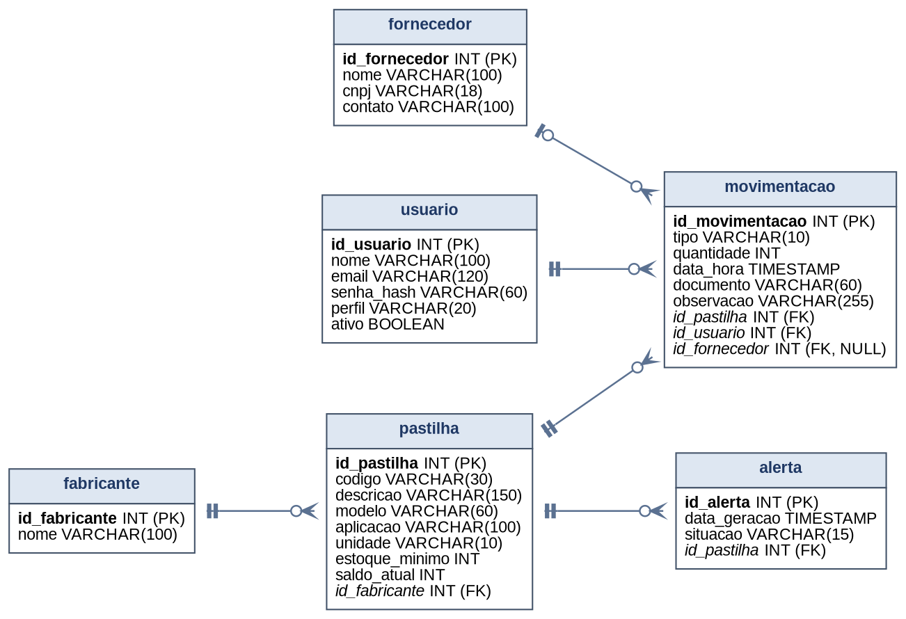

<p align="center">
  <picture>
    <source media="(prefers-color-scheme: dark)" srcset="docs/marca/pastrack-logo-claro.svg">
    
  </picture>
</p>

# PasTrack

[](https://github.com/thiagodorgo/PasTrack/actions/workflows/ci.yml)


Sistema web para controle de estoque de pastilhas industriais de corte. Ele substitui a planilha da DDA Usinagem Industrial por um sistema instalado na rede da empresa, com cadastro de pastilhas, fabricantes e fornecedores, entradas e saídas com validação de saldo, alerta automático de estoque mínimo, painel com a situação geral e histórico de todas as movimentações. O acesso é por perfil, e a permissão é conferida no servidor.

## Sumário

- [Sobre o projeto](#sobre-o-projeto)
- [Funcionalidades](#funcionalidades)
- [Telas](#telas)
- [Arquitetura](#arquitetura)
- [Modelagem de dados](#modelagem-de-dados)
- [Tecnologias](#tecnologias)
- [Perfis de acesso](#perfis-de-acesso)
- [Pré-requisitos](#pré-requisitos)
- [Como executar](#como-executar)
- [Testes](#testes)
- [Problemas comuns](#problemas-comuns)
- [Estrutura do projeto](#estrutura-do-projeto)
- [Documentação](#documentação)
- [Fluxo de trabalho e contribuição](#fluxo-de-trabalho-e-contribuição)
- [Versão](#versão)
- [Equipe](#equipe)

## Sobre o projeto

O PasTrack foi desenvolvido na unidade curricular Projeto Aplicado IV do Centro Universitário SENAI Santa Catarina, a partir de uma demanda real da DDA Usinagem Industrial publicada na plataforma SAGA SENAI de Inovação.

A empresa controlava o estoque de pastilhas de corte numa planilha. A planilha ficava num computador, era editada por várias pessoas e não avisava quando um item chegava ao fim. O resultado era parada de máquina por falta de pastilha, compra em duplicidade e dificuldade de saber quem deu baixa em quê.

O PasTrack resolve esses três pontos:

- o alerta de reposição abre sozinho quando o saldo chega ao estoque mínimo, antes de faltar pastilha na máquina;
- o saldo fica num lugar só, muda só por movimentação e nunca fica negativo, então todos veem o mesmo estoque antes de comprar;
- cada movimentação guarda quem registrou, quando e com qual documento.

O escopo, os atores e o que ficou para depois estão em [docs/requisitos.md](docs/requisitos.md).

## Funcionalidades

| Área            | O que o sistema faz                                                                                                                          |
| --------------- | -------------------------------------------------------------------------------------------------------------------------------------------- |
| Acesso e contas | Login com e-mail e senha, troca obrigatória de senha no primeiro acesso, cadastro de usuários por perfil, desativação e redefinição de senha |
| Cadastros       | Pastilhas com código único e estoque mínimo, fabricantes com nome único e fornecedores com CNPJ validado                                     |
| Movimentação    | Entradas com fornecedor e saídas com validação de saldo, numa operação atômica que nunca deixa o estoque negativo                            |
| Alertas         | Abertura automática no estoque mínimo, fechamento automático na reposição e resolução manual com confirmação. Mínimo zero desliga o alerta   |
| Painel          | Total de pastilhas, itens críticos, alertas abertos, barras de saldo contra estoque mínimo dos itens críticos e últimas movimentações        |
| Rastreabilidade | Histórico de movimentações com filtros e paginação, e trilha de auditoria de cadastros, senhas e alertas                                     |

São 24 requisitos funcionais, 11 regras de negócio e 12 requisitos não funcionais, cada um com código para rastreio no [plano de testes](docs/testes/plano-de-testes.md). A lista completa está em [docs/requisitos.md](docs/requisitos.md).

O front-end tem dez telas: login, troca de senha, painel, pastilhas, movimentações, alertas, fabricantes, fornecedores, usuários e acesso negado, além da página de endereço não encontrado.

## Telas

<table>
  <tr>
    <td width="50%"><br><b>Login.</b> Entrada com e-mail e senha.</td>
    <td width="50%"><br><b>Painel.</b> Indicadores, nível dos itens críticos contra o estoque mínimo e últimas movimentações.</td>
  </tr>
  <tr>
    <td width="50%"><br><b>Pastilhas.</b> Busca por código ou descrição e situação de cada item.</td>
    <td width="50%"><br><b>Movimentações.</b> Registro de entrada ou saída e histórico.</td>
  </tr>
  <tr>
    <td width="50%"><br><b>Saldo insuficiente.</b> A saída maior que o saldo é recusada.</td>
    <td width="50%"><br><b>Alertas.</b> Itens que chegaram ao estoque mínimo, com resolução manual.</td>
  </tr>
</table>

As demais telas, como usuários e acesso negado, estão em [docs/imagens/](docs/imagens/). O uso de cada uma está no [manual do usuário](docs/manual-do-usuario.md).

## Arquitetura

A aplicação tem três camadas:

1. **Apresentação:** SPA em React, servida pelo nginx. O mesmo nginx encaminha as chamadas de `/api` para a API.
2. **Aplicação:** API REST em Node.js com Express, organizada em rotas, controllers, services e repositories.
3. **Dados:** PostgreSQL, acessado pelo Prisma ORM, com migrations versionadas.



No Docker Compose, só o nginx aceita conexões da rede. A API não publica porta no host, e o banco fica acessível apenas na própria máquina.

O caminho de uma requisição, as camadas da API e o registro de uma movimentação estão em [docs/arquitetura.md](docs/arquitetura.md). As decisões que levaram a esse desenho estão nos [ADRs](docs/decisoes/README.md).

## Modelagem de dados

O banco do PasTrack foi modelado em duas etapas: primeiro o modelo conceitual, na notação de Peter Chen, e depois o modelo lógico, já no formato relacional com as chaves primárias e estrangeiras definidas.

O modelo tem seis entidades. A pastilha é o centro: cada uma pertence a um fabricante e guarda o estoque mínimo configurado e o saldo atual. A movimentacao registra tanto as entradas quanto as saídas (campo tipo), sempre com o usuario responsável pelo lançamento; nas entradas, ela também pode indicar o fornecedor de origem. Quando o saldo de um item chega ao estoque mínimo, o sistema gera um registro em alerta, que fica aberto até a reposição.

O banco implementado tem uma sétima tabela, `auditoria`, que guarda a trilha de alterações de cadastros, senhas e alertas. Ela não aparece nos diagramas e está descrita em [docs/banco-de-dados.md](docs/banco-de-dados.md).

### Modelo conceitual



### Modelo lógico



O dicionário de dados, as restrições, os índices e a política de migrations estão em [docs/banco-de-dados.md](docs/banco-de-dados.md).

## Tecnologias

| Camada              | Tecnologia                                          | Versão                     |
| ------------------- | --------------------------------------------------- | -------------------------- |
| Front-end           | React, React Router, Axios                          | 18.3, 7.18, 1.21           |
| Ícones e fontes     | Lucide React, Fontsource (Inter e JetBrains Mono)   | 0.460, 5.1                 |
| Build do front-end  | Vite                                                | 6.4                        |
| Back-end            | Node.js, Express                                    | 20, 4.22                   |
| Linguagem           | TypeScript                                          | 5.9                        |
| Banco de dados      | PostgreSQL, Prisma ORM                              | 16, 5.22                   |
| Validação           | Zod                                                 | 4.6                        |
| Autenticação        | JWT (jsonwebtoken), hash de senha com bcrypt        | 9.0, bcryptjs 3.0          |
| Segurança e logs    | Helmet, express-rate-limit, Pino                    | 8.3, 8.7, 10.3             |
| Servidor web        | nginx (imagem `nginxinc/nginx-unprivileged`)        | 1.27                       |
| Testes              | Vitest, Supertest, Testing Library, MSW, Playwright | 4.1, 7.2, 16.3, 2.15, 1.63 |
| Qualidade de código | ESLint, Prettier                                    | 9.39, 3.9                  |
| Implantação         | Docker Compose                                      | v2                         |
| Integração contínua | GitHub Actions                                      | -                          |

As versões vêm dos `package.json` de [backend](backend/package.json), [frontend](frontend/package.json) e [e2e](e2e/package.json), dos Dockerfiles e do [docker-compose.yml](docker-compose.yml).

## Perfis de acesso

O sistema tem quatro perfis. A permissão é conferida no servidor, em cada rota.

| Ação                              | ADMINISTRADOR | GESTOR | OPERADOR | COMPRADOR |
| --------------------------------- | :-----------: | :----: | :------: | :-------: |
| Consultar os dados do sistema     |      sim      |  sim   |   sim    |    sim    |
| Cadastrar pastilhas e fabricantes |      sim      |  sim   |   não    |    não    |
| Cadastrar fornecedores            |      sim      |  sim   |   não    |    sim    |
| Registrar entrada                 |      sim      |  sim   |   sim    |    sim    |
| Registrar saída                   |      sim      |  sim   |   sim    |    não    |
| Resolver alerta manualmente       |      sim      |  sim   |   não    |    não    |
| Gerenciar usuários e acesso       |      sim      |  não   |   não    |    não    |

A matriz completa, gerada a partir de [backend/src/config/permissoes.ts](backend/src/config/permissoes.ts) com `npm run docs:perfis`, está em [docs/perfis-e-permissoes.md](docs/perfis-e-permissoes.md). O motivo do papel do comprador está no [ADR-0003](docs/decisoes/ADR-0003-matriz-de-perfis-e-papel-do-comprador.md).

## Pré-requisitos

Para rodar o sistema com Docker, que é o caminho recomendado:

- Docker com Docker Engine 25 ou mais novo e o Docker Compose v2. No Windows 11, use o Docker Desktop.
- Git, para baixar o código.

Para o modo de desenvolvimento e para os testes, também:

- Node.js 20 ou superior, com npm. A versão do projeto está em [.nvmrc](.nvmrc).

Confira as versões:

```bash
docker version           # em "Server", a versão deve ser 25 ou mais nova
docker compose version   # deve ser v2
node --version           # só para desenvolvimento e testes
```

## Como executar

### Com Docker (início rápido)

Um único comando sobe o banco, a API e o front-end servido pelo nginx.

**1. Baixe o código**

```bash
git clone https://github.com/thiagodorgo/PasTrack.git
cd PasTrack
```

**2. Crie o `.env`**

```bash
cp .env.example .env            # Linux ou Git Bash
```

```powershell
Copy-Item .env.example .env     # PowerShell
```

**3. Gere os segredos**

Rode o comando abaixo duas vezes: uma para `POSTGRES_PASSWORD` e outra para `JWT_SECRET`.

```bash
node -e "console.log(require('crypto').randomBytes(48).toString('base64url'))"
```

Sem Node.js na máquina, rode o mesmo comando num container:

```bash
docker run --rm node:20-bookworm-slim node -e "console.log(require('crypto').randomBytes(48).toString('base64url'))"
```

**4. Preencha as variáveis obrigatórias no `.env`**

| Variável            | O que colocar                                                                                                    |
| ------------------- | ---------------------------------------------------------------------------------------------------------------- |
| `POSTGRES_PASSWORD` | Um dos valores gerados. Só letras, números, `-` e `_`.                                                           |
| `JWT_SECRET`        | O outro valor gerado. Pelo menos 32 caracteres.                                                                  |
| `SEED_ADMIN_SENHA`  | A senha do administrador inicial: 12 caracteres ou mais, com letra e número, sem a parte do e-mail antes do `@`. |

As outras variáveis já têm um valor padrão. A tabela completa está no [guia de implantação](docs/deploy.md#o-que-cada-variável-faz).

**5. Suba o sistema**

```bash
docker compose up -d --build --wait
```

A primeira subida leva alguns minutos, porque as imagens são construídas. O `--wait` só devolve o terminal quando os três serviços estão saudáveis. A cada subida, a API aplica as migrations pendentes e cria o administrador inicial, se ele ainda não existir.

**6. Confira a saúde**

```bash
docker compose ps                              # os três serviços devem aparecer como healthy
curl http://localhost:8080/api/health          # no PowerShell, use curl.exe
```

A resposta esperada é parecida com:

```json
{ "status": "ok", "banco": "ok", "versao": "1.0.0-rc.1", "uptimeSegundos": 42 }
```

**7. Faça o primeiro acesso**

1. Abra http://localhost:8080.
2. Entre com `admin@pastrack.local` (o valor de `SEED_ADMIN_EMAIL`) e a senha de `SEED_ADMIN_SENHA`.
3. O sistema pede uma senha nova, porque o administrador inicial nasce com a troca obrigatória. Escolha a senha e guarde-a.
4. Cadastre os demais usuários na tela de **Usuários**. Cada usuário novo recebe uma senha temporária, mostrada uma única vez, e troca a senha no primeiro acesso.

Outros computadores da rede acessam pelo IP desta máquina, na porta de `WEB_PORTA` (`8080`). A liberação no firewall está no [guia de implantação](docs/deploy.md#acesso-pelos-outros-computadores-da-rede).

**Parar e zerar**

```bash
docker compose down      # para os containers; os dados ficam no volume dados-banco
docker compose down -v   # para e apaga o banco
```

### Usuários de demonstração

Para apresentar o sistema com dados prontos, defina no `.env`, antes da primeira subida:

```text
SEED_DEMO=true
SEED_DEMO_SENHA=<senha com 12 caracteres ou mais, com letra e número>
```

Com isso, a API carrega dois fabricantes, dois fornecedores, três pastilhas e um usuário de cada perfil, definidos em [backend/src/scripts/dados-demonstracao.ts](backend/src/scripts/dados-demonstracao.ts):

| Perfil    | E-mail                     | Senha                           | O que demonstra                                    |
| --------- | -------------------------- | ------------------------------- | -------------------------------------------------- |
| GESTOR    | `gestor@pastrack.local`    | a definida em `SEED_DEMO_SENHA` | Cadastros, entradas, saídas e resolução de alertas |
| OPERADOR  | `operador@pastrack.local`  | a definida em `SEED_DEMO_SENHA` | Registro de saídas e bloqueio da tela de usuários  |
| COMPRADOR | `comprador@pastrack.local` | a definida em `SEED_DEMO_SENHA` | Registro de entradas e cadastro de fornecedores    |

Os usuários de demonstração não precisam trocar a senha no primeiro acesso. O administrador continua sendo o de `SEED_ADMIN_EMAIL`.

Os usuários de demonstração são criados uma vez. Mudar `SEED_DEMO_SENHA` depois não altera a senha deles. Se `SEED_DEMO_SENHA` ficar vazia, a API gera uma senha a cada subida e a mostra no log, e só a da primeira subida vale. Por isso, defina sempre a senha.

Não use `SEED_DEMO=true` na instalação real da empresa. O roteiro da apresentação está em [docs/roteiro-demo.md](docs/roteiro-demo.md).

### Modo de desenvolvimento

No modo de desenvolvimento, a API e o front-end rodam direto no Node.js, com recarga automática. O banco pode ser o do Docker Compose.

**1. Suba só o banco**

Com o `.env` da raiz preenchido (passos 2 a 4 acima):

```bash
docker compose up -d banco
```

**2. Back-end** (em um terminal)

```bash
cd backend
cp .env.example .env
npm ci
npm run db:deploy      # aplica as migrations versionadas
npm run db:seed        # cria o administrador inicial
npm run dev
```

No `backend/.env`, ajuste a `DATABASE_URL` com a senha de `POSTGRES_PASSWORD` (e a porta de `DB_PORTA`, se mudou) e preencha `JWT_SECRET`. Se `SEED_ADMIN_SENHA` ficar vazia, o seed gera uma senha e a mostra uma única vez. Para os dados de demonstração, defina `SEED_DEMO=true` e `SEED_DEMO_SENHA` e rode `npm run db:seed:demo`.

A API sobe em http://localhost:3333. Detalhes em [backend/README.md](backend/README.md).

**3. Front-end** (em outro terminal)

```bash
cd frontend
cp .env.example .env
npm ci
npm run dev
```

A aplicação abre em http://localhost:5173 e encaminha as chamadas de `/api` para a API em http://localhost:3333. Detalhes em [frontend/README.md](frontend/README.md).

Antes de abrir um pull request, suba o banco de teste (veja [Testes](#testes)) e rode na raiz:

```bash
npm run lint
npm run typecheck
npm run format:check
npm run test:tudo
npm run build
```

## Testes

O projeto tem testes de unidade, de integração com banco real, de tela e ponta a ponta.

| Nível                  | O que cobre                                                   | Ferramentas                         |
| ---------------------- | ------------------------------------------------------------- | ----------------------------------- |
| Unidade                | Política de senha, permissões, validação, erros e ambiente    | Vitest                              |
| Integração e segurança | A API inteira contra um PostgreSQL de verdade, rota por rota  | Vitest e Supertest                  |
| Componentes e telas    | As telas do front-end, com a API simulada                     | Vitest, Testing Library e MSW       |
| Ponta a ponta          | O sistema inteiro no ar, pelo navegador, num ambiente próprio | Playwright, contra o Docker Compose |

**Backend e frontend**

```bash
npm run instalar                                         # dependências do backend e do frontend
docker compose -f docker-compose.test.yml up -d --wait   # banco de teste, na porta 5433
npm run test:tudo                                        # backend e frontend
docker compose -f docker-compose.test.yml down -v
```

Para a cobertura, use `npm run test:cov --prefix backend` e `npm run test:cov --prefix frontend`.

**Ponta a ponta**

Rodam num ambiente separado, com o site em `127.0.0.1:8093` e o banco em `127.0.0.1:5438`:

```bash
npm ci --prefix e2e
npm run instalar-navegador --prefix e2e   # só na primeira vez
docker compose --env-file .env.e2e -f docker-compose.yml -f docker-compose.e2e.yml up -d --build --wait
npm run e2e
docker compose --env-file .env.e2e -f docker-compose.yml -f docker-compose.e2e.yml down -v
```

Mais detalhes em [e2e/README.md](e2e/README.md) e em [docs/testes.md](docs/testes.md#ponta-a-ponta).

**Última execução registrada** (`2026-09-19_17e4380`)

| Suíte    | Testes | Falhas | Cobertura de linhas |
| -------- | -----: | -----: | ------------------: |
| backend  |    725 |      0 |              98,56% |
| frontend |    300 |      0 |              97,14% |
| e2e      |     22 |      0 |                   - |

As evidências de cada execução ficam em [tests/results/](tests/results/README.md), com o histórico em [HISTORICO.md](tests/results/HISTORICO.md). A estratégia está em [docs/testes.md](docs/testes.md), e o que cada teste prova está no [plano de testes](docs/testes/plano-de-testes.md).

Para conferir uma instalação recém-criada de ponta a ponta, use `npm run verificar:implantacao`, descrito no [guia de implantação](docs/deploy.md#conferir-a-instalação).

## Problemas comuns

| Sintoma                                                                 | Causa                                                              | O que fazer                                                                                                                                                                                         |
| ----------------------------------------------------------------------- | ------------------------------------------------------------------ | --------------------------------------------------------------------------------------------------------------------------------------------------------------------------------------------------- |
| `port is already allocated` ou `ports are not available` na porta 5432  | Outro PostgreSQL já usa a porta nesta máquina                      | No `.env`, troque `DB_PORTA` para uma porta livre, como `5434`, e rode `docker compose up -d --wait`. No modo de desenvolvimento, ajuste a porta na `DATABASE_URL` do `backend/.env`.               |
| A mesma mensagem na porta 8080                                          | Outro programa já usa a porta do site                              | Troque `WEB_PORTA`, por exemplo para `8081`, e acesse http://localhost:8081.                                                                                                                        |
| O comando `docker` não consegue se conectar ao Docker                   | O Docker Desktop ou o serviço do Docker não está rodando           | Abra o Docker Desktop e espere ele terminar de iniciar. Confira com `docker version`: a seção "Server" precisa aparecer.                                                                            |
| `required variable POSTGRES_PASSWORD is missing a value`                | Variável obrigatória vazia no `.env`                               | Preencha a variável citada. Confira se o `.env` está na pasta onde o comando rodou.                                                                                                                 |
| `container pastrack-api-1 is unhealthy` ou `dependency failed to start` | Configuração inválida, senha do banco ou migration                 | Veja o motivo com `docker compose logs api --tail 50` e siga a tabela do [guia de implantação](docs/deploy.md#api-unhealthy).                                                                       |
| Mudou o `.env` e nada mudou                                             | O `docker compose restart` não relê o `.env`                       | Rode `docker compose up -d --wait`.                                                                                                                                                                 |
| Esqueceu a senha do administrador                                       | Mudar `SEED_ADMIN_SENHA` não altera um administrador que já existe | Rode `docker compose exec api node dist/scripts/redefinir-senha-admin.js admin@pastrack.local`. O passo a passo está no [manual de operação](docs/operacao.md#recuperar-o-acesso-do-administrador). |
| A senha de demonstração não funciona                                    | Os usuários de demonstração já existiam com outra senha            | A senha vale só na criação. Use a senha da primeira subida ou zere o banco com `docker compose down -v`, o que apaga todos os dados.                                                                |
| O login responde que é preciso esperar                                  | 5 senhas erradas em 15 minutos para o mesmo e-mail e IP            | Espere o tempo indicado. É a proteção contra força bruta.                                                                                                                                           |

Outros casos estão em [docs/deploy.md](docs/deploy.md#problemas-comuns) e no [manual de operação](docs/operacao.md).

## Estrutura do projeto

```
PasTrack/
├── .github/                 CI (GitHub Actions), modelos de PR e de issue, CODEOWNERS e Dependabot
├── backend/                 API REST em Node.js, Express e Prisma (ver backend/README.md)
│   ├── prisma/              schema e migrations versionadas
│   ├── src/
│   │   ├── routes/          caminhos da API e sequência de middlewares
│   │   ├── controllers/     entrada e saída HTTP
│   │   ├── services/        regras de negócio e transações
│   │   ├── repositories/    consultas e gravações com Prisma
│   │   ├── schemas/         validação de entrada com Zod
│   │   ├── middlewares/     autenticação, autorização, validação, limites e erros
│   │   ├── config/          ambiente, banco e matriz de permissões
│   │   └── scripts/         seed, dados de demonstração e recuperação do administrador
│   └── tests/               testes de unidade, integração e segurança
├── frontend/                SPA em React e Vite (ver frontend/README.md)
│   ├── src/
│   │   ├── pages/           as telas do sistema
│   │   ├── components/      componentes compartilhados
│   │   ├── contexts/        sessão do usuário
│   │   └── services/        cliente da API
│   ├── public/              ícone da aba do navegador e atalho do celular
│   ├── tests/               testes de tela e de componente
│   └── nginx.conf           servidor do site e proxy de /api
├── e2e/                     testes ponta a ponta com Playwright (ver e2e/README.md)
├── docs/                    documentação, diagramas, ADRs e capturas de tela
│   └── marca/               logo, símbolo e ícone do PasTrack (ver docs/marca/README.md)
├── scripts/                 relatório de testes, gerador da matriz de perfis e conferência da instalação (ver scripts/README.md)
├── tests/results/           evidências versionadas das execuções de teste
├── docker-compose.yml       banco, API e site
├── docker-compose.test.yml  banco dos testes de integração
├── docker-compose.e2e.yml   ambiente dos testes ponta a ponta
├── .env.example             modelo do .env da raiz
└── package.json             scripts que rodam backend e frontend juntos
```

## Documentação

| Para                                | Leia                                                                                                                |
| ----------------------------------- | ------------------------------------------------------------------------------------------------------------------- |
| saber o que o sistema precisa fazer | [Requisitos](docs/requisitos.md)                                                                                    |
| usar o sistema no dia a dia         | [Manual do usuário](docs/manual-do-usuario.md)                                                                      |
| instalar na empresa                 | [Guia de implantação](docs/deploy.md)                                                                               |
| cuidar do sistema no servidor       | [Manual de operação](docs/operacao.md)                                                                              |
| entender a arquitetura              | [Arquitetura](docs/arquitetura.md) e [ADRs](docs/decisoes/README.md)                                                |
| conhecer o banco de dados           | [Banco de dados](docs/banco-de-dados.md)                                                                            |
| integrar com a API                  | [Contrato da API](docs/api.md)                                                                                      |
| conferir os perfis                  | [Perfis e permissões](docs/perfis-e-permissoes.md)                                                                  |
| entender a segurança                | [Segurança](docs/seguranca.md), [ASVS nível 1](docs/seguranca/asvs-l1-checklist.md) e [SECURITY.md](SECURITY.md)    |
| conferir os testes                  | [Testes](docs/testes.md), [Plano de testes](docs/testes/plano-de-testes.md) e [resultados](tests/results/README.md) |
| apresentar o sistema                | [Roteiro da demonstração](docs/roteiro-demo.md)                                                                     |
| contribuir com o código             | [CONTRIBUTING.md](CONTRIBUTING.md)                                                                                  |

O índice completo está em [docs/README.md](docs/README.md).

## Fluxo de trabalho e contribuição

- **Branches:** cada mudança nasce de uma branch criada a partir da `main`, no formato `tipo/descricao-em-kebab-case`, como `docs/padronizacao-entrega`. Os tipos são `feat`, `fix`, `docs`, `test`, `chore`, `ci`, `refactor`, `style`, `perf` e `build`.
- **Commits:** em português, no formato [Conventional Commits](https://www.conventionalcommits.org/pt-br/v1.0.0/), como `fix(estoque): impede saldo negativo`.
- **Pull requests:** seguem o [modelo do repositório](.github/pull_request_template.md), com o que mudou e como foi verificado. O merge é por squash, depois da revisão.
- **Integração contínua:** o [workflow de CI](.github/workflows/ci.yml) roda em cada pull request e em cada push na `main`. Os checks `backend`, `frontend` e `compose-smoke` são obrigatórios: lint, formatação, tipos, testes com cobertura, build, auditoria das dependências e a subida completa com Docker Compose.
- **Manutenção:** o Dependabot propõe atualizações semanais das dependências, e as issues usam os modelos de [defeito](.github/ISSUE_TEMPLATE/defeito.md) e de [melhoria](.github/ISSUE_TEMPLATE/melhoria.md).

O guia completo, com o preparo do ambiente, migrations e estilo de código, está em [CONTRIBUTING.md](CONTRIBUTING.md). As mudanças de cada versão ficam no [CHANGELOG.md](CHANGELOG.md).

## Versão

A versão atual é a `1.0.0-rc.1`, de 19/09/2026, marcada com a tag `v1.0.0-rc.1`. O que entrou em cada versão está no [CHANGELOG.md](CHANGELOG.md), que segue o Keep a Changelog e o Versionamento Semântico.

## Equipe

| Integrante      | GitHub                                                                       |
| --------------- | ---------------------------------------------------------------------------- |
| Thiago Araújo   | [@thiagodorgo](https://github.com/thiagodorgo)                               |
| Fabrício Alves  | [@Fabricio-P-Alves](https://github.com/Fabricio-P-Alves)                     |
| Joseph Correa   | [@CorreaJoseph](https://github.com/CorreaJoseph)                             |
| Péttrin Miranda | [@desenvolvimentoexpansetech](https://github.com/desenvolvimentoexpansetech) |

Projeto desenvolvido na unidade curricular Projeto Aplicado IV do Centro Universitário SENAI Santa Catarina.
